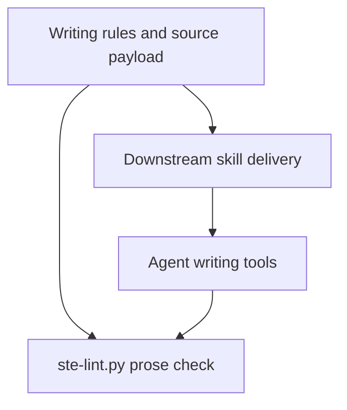
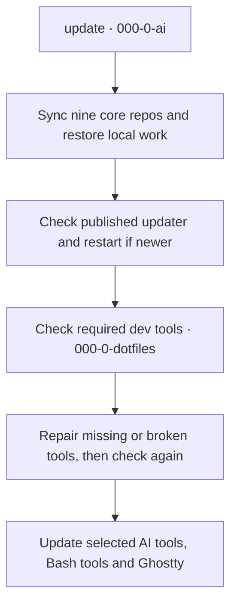

# ASD-STE100 writing skill



<!-- key-information:start -->
## Key information

- **Description:** Provides Simplified Technical English writing rules and a prose checker to help readers understand technical documents.
- **Tier:** `0`. Core. Every project must follow its rules, with no exceptions.
- **Needs:** Nothing.
- **Gives:** The writing rules and the STE check for the documents of all folders.
- **On a new computer:** set it up step 2 of 7 in the core tier.

This folder is part of the `~/Apps` SOP (Standard Operating Procedure). The
number in the name of each folder is its tier. The SOP map is a private page. Its link is in the README of
`000-0-workspace`. Open it, and then select the **ASD-STE100** tab.

| Folder | Tier | Goal | GitHub |
|---|---|---|---|
| `000-0-dotfiles` | 0 | Every computer works the same way | [000-0-dotfiles](https://github.com/kairin/000-0-dotfiles) |
| **000-0-ASD-STE100** | 0 | Every document is clear to a reader who is not a developer | [000-0-ASD-STE100](https://github.com/kairin/000-0-ASD-STE100) |
| `000-0-password` | 0 | No key gets to a program that does not need it | [000-0-password](https://github.com/kairin/000-0-password) |
| `000-0-ai` | 0 | AI tools work the same way on every computer and follow the SOP | [000-0-ai](https://github.com/kairin/000-0-ai) |
| `000-0-workspace` | 0 | All repositories in `~/Apps` stay healthy and consistent | [000-0-workspace](https://github.com/kairin/000-0-workspace) |
| `000-0-tables` | 0 | You never research the same database question twice, and what you know links across repositories | [000-0-tables](https://github.com/kairin/000-0-tables) |
| `000-0-ghostty` | 0 | The terminal is current, verified and the same on every computer | [000-0-ghostty](https://github.com/kairin/000-0-ghostty) |
| `000-111-learn` | 111 | Write very small, fast programs that run close to the hardware | [000-111-learn](https://github.com/kairin/000-111-learn) |
<!-- key-information:end -->

A skill that rewrites prose (docs, READMEs, PR descriptions, error
messages, release notes, comments, tool descriptions, system prompts. Never
code) into ASD-STE100 Simplified Technical English, to remove "AI slop".

This repository holds the `ste-writing` skill and its supporting files.
It follows the method shown in the video and source repository below.

The skill is for Hermes, Pi, OpenAI Codex CLI, and Google Antigravity (`agy`).
The delivery map is in [docs/ste-delivery.md](docs/ste-delivery.md).
The downstream delivery work is tracked in
[000-0-ASD-STE100 issue #10](https://github.com/kairin/000-0-ASD-STE100/issues/10).

## Workspace layout

This repository lives at `~/Apps/000-0-ASD-STE100`. The table in "Key
information" above lists the other five `000-0-` folders.

Three places in the configuration of the AI tools on this computer point to
files in this folder:

- the global rule to write in STE;
- a hook that runs `ste-lint.py` after each write to a `.md`, `.mdx` or
  `.txt` file;
- three links to the skill files.

## Core system contract and public boundary

The full owner system requires the complete manifest-declared core repository set.
See `../000-0-manifest/docs/core-system-contract.md` and `../000-0-manifest/core-layout.json`
once published in `M-01` and `M-03`. This checkout alone is partial.

`000-0-manifest` stays public. It contains no personal data and no secrets.
Report missing members, instructions, or an unestablished shipment baseline as incomplete.
Do not clone, install, or reset to fix missing members.
Local `ste-lint.py` and `scripts/check-ste-payload.sh` checks stay independent.

## References

- Video: [The Cure for AI Slop](https://www.youtube.com/watch?v=uJblcC4lKYw&t=9s)
- Source: [woosal1337/blog, videos/ep01-the-cure-for-ai-slop](https://github.com/woosal1337/blog/tree/main/videos/ep01-the-cure-for-ai-slop)

## Why this works

ASD-STE100 began in 1986. European aircraft makers needed maintenance
manuals that any mechanic could read, including readers whose first
language was not English.

The standard rests on two pillars. The first is procedural rules: one
instruction per sentence, active voice, no semicolons. The second is a
controlled dictionary of about 900 approved words, each word with one
meaning.

Six writing habits create most AI slop. Each habit has a matching rule:

| Habit | Rule |
|---|---|
| Synonym rotation | 1.11, one name for one thing |
| Hedging stacks | 3.4, no stacked auxiliaries |
| Nominalization | 3.7, use a verb for an action |
| Marketing adjectives | the controlled dictionary |
| Run-on sentences | 5.1 and 6.3, the length caps |
| Phrasal verbs | 9.3, no phrasal verbs |

A 1996 study found ASD-STE100 raised reader comprehension. The score went
from 76% to 86% for all readers, and from 69% to 87% for readers whose
first language was not English. A 2007 Microsoft Research study ran 520
sentences through 4 languages. The largest single gain came from removing
flowery, indirect text.

`ste-lint.py` is a denylist check, not full Issue 9 conformance. It does not
load the approved dictionary.

One caution: oversimplified text can slow reading for an expert reader
who already knows the subject. STE trades some of that speed for a wider
group of readers who can read the text without error.

## Contents

| File or path | Purpose |
|---|---|
| `ste-writing-skill.md` | The skill definition (rules, modes, guards) |
| `ste-lint.py` | Heuristic anti-slop denylist used to score drafts |
| `ste-recurring-errors.md` | Reference list of common writer errors in ASD-STE100 |
| `ste-system-append.md` | Standing rule for tool instruction files |
| `ste-senior-engineer-prompt.md` | Unified senior-engineer and ASD-STE100 system prompt |
| `skills/ste-writing/` | Derived skill package (`SKILL.md`, `ste-lint.py`, `ste-recurring-errors.md`) |
| `docs/ste-delivery.md` | Canonical payload and destination map |
| `scripts/check-ste-payload.sh` | Local source, package, destination, and purge checks |
| `AGENTS.md` | Standing rule for harnesses that read that file |

## Install

This repository is the source of the five canonical payload files. Author all content here.

Delivery uses manual stages:

1. Five canonical source files live in the root of this repository.
2. Three derived skill package files live in `skills/ste-writing/`: `SKILL.md`, `ste-lint.py`, and `ste-recurring-errors.md`.
3. Copy `skills/ste-writing/` by hand to installed tool skill directories:
   - `~/.agents/skills/ste-writing/` (portable directory for Hermes, Pi, OpenAI Codex CLI, and Google Antigravity)
   - `~/.hermes/skills/ste-writing/` (vendor directory for Hermes)
   - `~/.gemini/config/skills/ste-writing/` (vendor directory for Google Antigravity)

The other two files stay separate manual files:
- `ste-system-append.md` is a manual standing rule. Add its text to a tool instruction file when needed.
- `ste-senior-engineer-prompt.md` is a manual prompt. Pass it as a system prompt when needed.

After you copy the files, run the checker from this repository:

```bash
uv run ste-lint.py README.md
```

This repository does not write files to a home directory.

## Use

Once delivered, the agent loads the skill when a task matches its
description (rewriting docs, READMEs, PR text, error messages), or when
you invoke `/ste-writing`.

To lint a draft from this repo:

```bash
uv run ste-lint.py draft.md            # flavored target: under 2.5 per 100 words
uv run ste-lint.py --strict draft.md   # strict target: under 1.5 per 100 words
```

Run the same command next to the skill file the agent loaded.

## Standing rule outside the skill trigger

The skill loads when a task matches its description. Copy the three derived skill package files to supported skill directories by hand. The standing rule file stays manual.

1. **Hermes.** The package uses the portable and Hermes vendor destinations.
2. **Pi.** The package uses the portable destination.
3. **OpenAI Codex CLI.** The package uses the portable destination.
4. **Google Antigravity (`agy`).** The package uses the portable and vendor
   destinations.

The complete file map is in [docs/ste-delivery.md](docs/ste-delivery.md).

## Unified senior-engineer prompt

`ste-senior-engineer-prompt.md` is one system prompt. It merges the language
rules of ASD-STE100 with operational rules for scope containment,
evidence-based completion, clean artifacts, reference codes, and four aliases.

Pass the file with the agent system-prompt option, or copy its content into
the system-prompt field of a tool.

The file must stay clean under its own check. Run
`uv run ste-lint.py --strict ste-senior-engineer-prompt.md`. The score must
be under 1.5 per 100 words.

Lint score v3 added the vocabulary of the prompt to the checker. The checker
now knows the `delve` family, `tapestry`, `loadbearing`, `load-bearing`,
`the honest truth`, the `streamline` family, two hedge phrases, and the
`look into` family. The em-dash count now skips code blocks and inline
code. The experiment numbers predate score v3. The version notes in
`ste-lint.py` record the history.

The clean-artifacts rule of the prompt bans co-author tags in commits. A
repo that keeps co-author trailers can remove the co-author words from that
bullet. The watermark ban and the metadata ban then stay.

## Notes

This is an unofficial, personal skill and is not affiliated with ASD. The
full ASD-STE100 standard is free at https://asd-ste100.org. ASD-STE100 is a
registered EU trademark (No. 017966390).

## Core repository sync and update procedure

Routine maintenance uses the `update` command. The command syncs the core repositories and updates applications.
For the complete procedure and tool ownership, see
[update and development tools](../000-0-workspace/docs/update-and-development-tools.md) and
the [shared update procedure](../000-0-ai/README.md#update-command).



This diagram shows the update flow. Diagrams do not prove runtime or shipment acceptance.
Source identity and accepted shipment stay separate until `G-SHIP` selection.
Local STE acceptance boundaries remain independent: `ste-lint.py` is an anti-slop denylist check,
not Issue 9 conformance.

## Workflow review — 2026-10-15

This review found no runtime defect in this repository. This repository owns
the writing rules for the review documents. Use these evidence terms in all
core documents: `observed`, `tested`, `source-reviewed`, and `proposed`.

Do not use `healthy`, `current`, or exit 0 as proof of a check that did not run.
Keep each repository note short. Put the full evidence in the owner's
[workflow review](../000-0-workspace/docs/update-workflow-review-2026-10-15.md).

## Office toolset and Node.js policy (2026-10-15)

The office toolset checks passed for ripgrep and the other required commands.
This does not establish STE conformance for a document.
Keep observed results separate from the owner's latest Node.js LTS target.
An approved version policy is not evidence that a computer already meets it.

See the [office installation record and shared version policy](../000-0-workspace/docs/office-toolset-2026-10-15.md).
